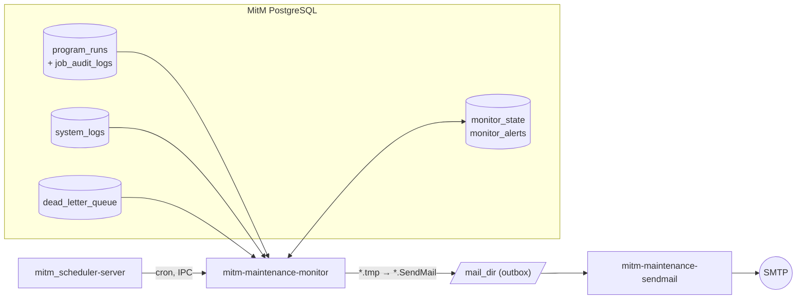

# MitM Maintenance Monitor


`mitm-maintenance-monitor` is a scheduled batch job of the **Man-in-the-Middle
(MitM) Data Aggregator**. It detects critical errors in the MitM database and
writes them as `*.SendMail` files into a mail outbox directory, from where
[`mitm_maintenance_sendmail`](https://github.com/Zheng-Bote/mitm_maintenance_sendmail)
sends them.

The monitor never sends mails itself and never touches encrypted data – it only
reads log and status tables.

> [!NOTE]
> Feature issue [#1](https://github.com/Zheng-Bote/mitm_maintenance_monitor/issues/1):
> phase 1 (failed/hanging runs, `system_logs`, dead letters) and phase 2
> (missed runs, `admin_audit_logs`, daily digest, heartbeat).

---

## Table of Contents

- [What Is Monitored](#what-is-monitored)
- [Architecture](#architecture)
- [Mail Files](#mail-files)
- [Missed Runs](#missed-runs)
- [Daily Digest and Heartbeat](#daily-digest-and-heartbeat)
- [Noise Control](#noise-control)
- [Reliability](#reliability)
- [Requirements](#requirements)
- [Build, Test and Install](#build-test-and-install)
- [Configuration](#configuration)
- [Scheduler Job Registration](#scheduler-job-registration)
- [Standalone Runtime Environment](#standalone-runtime-environment)
- [Scheduler Events](#scheduler-events)
- [Security and Privacy](#security-and-privacy)
- [Operations](#operations)
- [Project Layout](#project-layout)
- [License](#license)

---

## What Is Monitored

| Source | Detection | Category | Mail |
|---|---|---|---|
| `program_runs` | Finished run with `success = false` | `job` | Job name, run ID, exit code, start/end time and the `ERROR:` lines of `job_audit_logs` for that run (fallback: last `failed` message of `job_status_events`) |
| `program_runs` | Run without `finished_at` for longer than `hanging_minutes` | `job` | Job name, run ID, PID, start time, running time |
| `program_runs` | Successful run of a job with an open, mailed alert | `job` | Recovery mail (`[INFO]`) |
| `system_logs` | Level ≥ `min_level`, component not excluded | `system` | Component, level, time, message |
| `dead_letter_queue` | New entry with `resolved = false` | `dlq` | DLQ ID, package ID, error code, time, error message – **never the payload** |
| `scheduled_programs` | Enabled program without a run at a cron time within `grace_minutes` ([Missed Runs](#missed-runs)) | `job` | Job name, cron expression, expected time |
| `admin_audit_logs` | Entry with an action of `sources.admin_audit_logs.actions` (opt-in) | `security` | Action, user, time, log ID and allowlisted `details` fields |

Immediate runs without scheduled program (`program_id` NULL, e.g. file
uploads) are reported as job `Immediate_Trigger`; they never trigger a recovery
mail, because all immediate runs share this name.

The scheduler messages `Job <name> failed with code <code> (RunID: <id>)` and
`Error waiting for job …` in `system_logs` are skipped, because the same failure
is reported from `program_runs` with more detail.

---

## Architecture



One run:

1. Fetch the MitM database configuration via scheduler IPC (`get_credentials`;
   the Master Key is not used).
2. Read the cursors (`monitor_state`) and collect new entries of every enabled
   source that are older than 60 seconds (settle delay for late commits).
3. Load the alert state (`monitor_alerts`) and decide per event: mail,
   suppress or recover.
4. Bundle mails above `max_mails_per_run` into one summary mail.
5. **Write the mail files**, then commit cursors and alert state in **one**
   transaction.

---

## Mail Files

The files use the header-block format of `mitm_maintenance_sendmail`
([issue #1](https://github.com/Zheng-Bote/mitm_maintenance_sendmail/issues/1)):

```text
To: ops@example.com
Cc: admin@example.com
Subject: [MitM][ERROR] Job Collector mirror-dev Employee DE failed (RunID 3732, exit code 1)
X-MitM-Severity: ERROR
X-MitM-Category: job
X-MitM-Source: program_runs/3732

Job:         Collector mirror-dev Employee DE
Run ID:      3732
Exit code:   1
Started:     2026-11-09 16:42:01 UTC
Finished:    2026-11-09 16:42:59 UTC

Errors:
- Employee: mirror-dev_employee: ERROR: Failed to execute query on Oracle table 'employee': ORA-00904: "TA"."BOSS_PERNR": invalid identifier

Details: https://mitm.example.com

--
MitM Maintenance Monitor 0.2.0
```

| Subject | When |
|---|---|
| `[MitM][ERROR] Job <name> failed (RunID <id>, exit code <code>)` | Failed run |
| `[MitM][ERROR] Job <name> hanging (RunID <id>, running <n> min)` | Hanging run |
| `[MitM][INFO] Job <name> recovered (RunID <id>)` | First successful run after a mailed failure |
| `[MitM][ERROR] <component>: <message>` | `system_logs` error |
| `[MitM][ERROR] Dead letter: <error code>` | New dead letter |
| `[MitM][ERROR] Job <name> did not run at <time>` | Missed run |
| `[MitM][SECURITY] <action> by <user>` | Critical `admin_audit_logs` action |
| `[MitM][INFO] Daily digest <date>: <n> jobs with failures, <n> open alerts` | Daily digest |
| `[MitM][INFO] Monitor heartbeat <date>: <n> open alerts` | Heartbeat |
| `[MitM][ERROR] <n> further alerts` | Summary of mails above `max_mails_per_run` |

- File name: `mitm-monitor_<hash>.SendMail`, the hash is derived from the source
  entries of the mail (deterministic).
- Files are written as `*.tmp` with mode `0600` and renamed to `*.SendMail`, so
  SendMail never reads a half-written file.
- Header values never contain line breaks (no header injection).

> [!IMPORTANT]
> The header-block format requires
> [mitm_maintenance_sendmail#1](https://github.com/Zheng-Bote/mitm_maintenance_sendmail/issues/1).
> The current SendMail format (recipient = file name) cannot send these files.

---

## Missed Runs

For every enabled `scheduled_programs` entry the monitor computes the cron
times in `(last check, now − grace_minutes]` and reports every time without a
run that started within `[time − 1 min, time + grace_minutes]`.

- **Same semantics as the scheduler** (Rust crate `cron` 0.12, UTC): 5-field
  expressions become `0 <expr> *`; 6/7 fields and `@yearly`, `@monthly`,
  `@weekly`, `@daily`, `@hourly` are passed through; **day of week 1–7 with
  Sunday = 1** (`sun`…`sat`); **day of month AND day of week** must both match;
  `a/step` means `a`..max. The implementation was compared with the Rust crate
  on 19 expressions.
- A cron time is **not** missed while a previous run is still running – the
  scheduler never starts a job twice (long runs are reported as hanging).
- A program created or changed after a cron time is only checked from its
  change on.
- Several cron times of one job share one alert (suppression), and the next
  successful run sends the recovery mail.
- After a monitor outage only the last 24 hours are evaluated (audit warning).
- Programs with an invalid cron expression are never started by the scheduler;
  the monitor reports them as audit warning and in the heartbeat.
- If the **scheduler itself is down**, every due job is reported as missed –
  which is exactly the alarm wanted.

> [!NOTE]
> The Rust crate cannot look ahead across a year boundary for expressions with
> a year field. The scheduler is unaffected (it always computes from "now"),
> except a year-restricted job at midnight on January 1st, which the scheduler
> does not start – the monitor then correctly reports it as missed.

---

## Daily Digest and Heartbeat

Both are opt-in and written once per day after `hour_utc` (also if the monitor
runs later that day), to their own recipients.

**Digest** – the last 24 hours:

```text
Daily digest for the 24 hours before 2026-11-10 06:00:00 UTC.

Job runs
  Collector mirror-dev Employee              96 runs, 2 failed
  Transformation Employee                    24 runs, 0 failed

Job warnings (WARNING:): 2
     2× cdh: CDH_RE: WARNING: skipped request v2_rooms {"level_code":"L1"}: giving up after 4 attempts: HTTP 503

System warnings (WARN): 14
    11× http-server: HTTP 404 Not Found - GET /dashboard
     3× http-server: HTTP 403 Forbidden - GET /api/v1/logs/audit

Dead letter queue: 3 unresolved, 1 new, oldest 2026-11-09 12:00:00 UTC

Transformation errors: 5
     5× email / mail: invalid format

Open alerts: 1
  [job] Job Collector mirror-dev Employee failed (RunID 4440, exit code 1) (+4 suppressed)
```

Similar texts (numbers and UUIDs ignored) are grouped; at most 20 groups per
section. With `metadata_only` only the counts are shown.

**Heartbeat** – proof of life: monitor version, runs and failures of the last
24 hours, open alerts, programs with an invalid cron expression and the
position of every source. *If this mail does not arrive, the scheduler, the
monitor or the mail delivery is not running.*

---

## Noise Control

**Fingerprint** – an alert is identified by category, group (job name,
component or error code) and the error text with numbers and UUIDs removed.
`ERROR: query failed for run 3732` and `ERROR: query failed for run 3790` are
therefore the same alert.

**Repeat suppression** – within `suppress_repeat_minutes` after the last mail of
a fingerprint no new mail is written; the occurrences are counted. The next
mail after the window reports them:

```text
Suppressed:  11 further occurrences since 2026-11-09 16:42:59 UTC
```

**Recovery** – when a job with an open, mailed alert finishes successfully, all
its open alerts are closed and (with `recovery_mail`) one recovery mail is
written. A later failure is mailed immediately again.

**Rate limit** – at most `max_mails_per_run` mails per run; all further mails
are listed in one summary mail to the union of their recipients.

**Routing** – recipients per category (`job`, `system`, `dlq`); rules with
category `*` apply when no rule of the category exists.

---

## Reliability

- **Cursors** (`monitor_state`): `program_runs` by `(finished_at, id)`,
  `system_logs` by `id`, `dead_letter_queue` by `(failed_at, id)`.
- **First run** per source: the cursor is set to the current position, older
  entries are **not** reported (audit: `Initialized cursor of <source>`).
- **Settle delay**: only entries older than 60 seconds are processed, so rows
  committed late are not skipped.
- **Order**: mail files first, then cursors and alert state in one transaction
  (at-least-once). Because file names are deterministic, a repeated run after a
  crash overwrites the same files instead of creating duplicates – unless
  SendMail already sent them in between.
- **Retention**: the monitor must process entries before
  `mitm_maintenance_cleanup` deletes them. With a run every few minutes and
  retention in days this is not an issue.

---

## Requirements

- Go **1.27** (only for building)
- MitM PostgreSQL database with migration
  [`007_monitor_state.sql`](https://github.com/Zheng-Bote/mitm-2/blob/main/migrations/007_monitor_state.sql)
  applied (tables `monitor_state`, `monitor_alerts`)
- A mail outbox directory writable by the scheduler user, shared with
  `mitm_maintenance_sendmail`

---

## Build, Test and Install

```sh
go test ./...
./build.sh      # static binary, version from the Git tag, copied to ../../app/bin/
```

Read-only integration test against a real MitM database (runs the source
queries, writes nothing, works without migration 007):

```sh
MITM_DB_HOST=<host> MITM_DB_PORT=<port> MITM_DB_USER=<user> MITM_DB_PASSWORD=<password> MITM_DB_NAME=mitm \
  go test -tags integration -run TestReadOnlySources -v ./...
```

---

## Configuration

The scheduler passes `scheduled_programs.args` as the first command-line
argument.

### Full example

```json
{
  "mail_dir": "/var/lib/mitm/outbox",
  "subject_prefix": "[MitM prod]",
  "sources": {
    "program_runs":      { "enabled": true, "hanging_minutes": 120, "exclude_jobs": ["mitm_maintenance_monitor"] },
    "missed_runs":       { "enabled": true, "grace_minutes": 30, "exclude_jobs": [] },
    "system_logs":       { "enabled": true, "min_level": "ERROR", "exclude_components": ["mitm_maintenance_monitor"] },
    "dead_letter_queue": { "enabled": true },
    "admin_audit_logs":  {
      "enabled": true,
      "actions": ["ASSIGN_ROLES", "RESTORE_CONFIG", "KEY_ROTATION_SUCCESS",
                  "UPSERT_CREDENTIAL", "DELETE_CREDENTIAL", "UPSERT_TARGET_CREDENTIAL", "DELETE_TARGET_CREDENTIAL",
                  "FORBIDDEN_ACCESS", "USER_LOGIN_FAILED", "BOOTSTRAP_ADMIN_REGISTERED"],
      "detail_fields": ["method", "reason", "client_ip", "source_name", "topic", "operation", "roles"]
    }
  },
  "routing": [
    { "category": "job",      "to": ["ops@example.com"] },
    { "category": "system",   "to": ["mitm-admin@example.com"], "cc": ["ops@example.com"] },
    { "category": "security", "to": ["security@example.com"] },
    { "category": "*",        "to": ["mitm-admin@example.com"] }
  ],
  "digest":    { "enabled": true, "hour_utc": 6, "to": ["ops@example.com"] },
  "heartbeat": { "enabled": true, "hour_utc": 6, "to": ["mitm-admin@example.com"] },
  "suppress_repeat_minutes": 240,
  "recovery_mail": true,
  "max_mails_per_run": 20,
  "max_message_chars": 500,
  "metadata_only": false,
  "frontend_url": "https://mitm.example.com"
}
```

### Minimal example

```json
{
  "mail_dir": "/var/lib/mitm/outbox",
  "routing": [ { "category": "*", "to": ["ops@example.com"] } ]
}
```

### Privacy-sensitive environment

Error texts may contain business data. With `metadata_only` the mails contain
only job, run, time and severity plus the frontend link:

```json
{
  "mail_dir": "/var/lib/mitm/outbox",
  "routing": [ { "category": "*", "to": ["ops@example.com"] } ],
  "metadata_only": true,
  "frontend_url": "https://mitm.example.com"
}
```

### Reference

| Field | Required | Default | Description |
|---|:---:|---|---|
| `mail_dir` | ✅ | – | Outbox directory; must exist. |
| `routing` | ✅ | – | Rules `{category, to, cc}`; every enabled category needs a rule or a `*` rule. Plain addresses only (`ops@example.com`); the domain must contain a dot, as required by `mitm_maintenance_sendmail` (`ops@localhost` is rejected). |
| `subject_prefix` | | `[MitM]` | Prefix of every subject, e.g. `[MitM prod]`. |
| `sources.program_runs.enabled` | | `true` | Failed, hanging and recovered runs. |
| `sources.program_runs.hanging_minutes` | | `120` | Running time after which a run counts as hanging. |
| `sources.program_runs.exclude_jobs` | | `[]` | Job names (`scheduled_programs.name`) to ignore. |
| `sources.system_logs.enabled` | | `true` | `system_logs` entries. |
| `sources.system_logs.min_level` | | `ERROR` | `DEBUG`, `INFO`, `WARN` or `ERROR`. |
| `sources.system_logs.exclude_components` | | `["mitm_maintenance_monitor"]` | Components to ignore. |
| `sources.dead_letter_queue.enabled` | | `true` | New unresolved dead letters. |
| `sources.missed_runs.enabled` | | `true` | Missed runs of enabled scheduled programs (category `job`). |
| `sources.missed_runs.grace_minutes` | | `30` | Time after a cron time within which the run must have started. |
| `sources.missed_runs.exclude_jobs` | | `[]` | Job names to ignore. |
| `sources.admin_audit_logs.enabled` | | `false` | Critical admin actions (category `security`; needs a `security` or `*` route). |
| `sources.admin_audit_logs.actions` | | see full example | Actions to report, case-insensitive. The default list matches the action names of mitm-http-server 3.3.0 (see its API documentation, *Admin Audit Log*); client reports (`CLIENT_*`) never match. |
| `sources.admin_audit_logs.detail_fields` | | `[]` | Allowlist of `details` keys copied into the mail; `details` is never copied completely. |
| `digest.enabled` / `heartbeat.enabled` | | `false` | Daily digest / heartbeat mail. |
| `digest.hour_utc` / `heartbeat.hour_utc` | | `6` | Hour (UTC) after which the mail of the day is written. |
| `digest.to`, `.cc` / `heartbeat.to`, `.cc` | ✅ if enabled | – | Recipients of the daily mail. |
| `suppress_repeat_minutes` | | `240` | Suppression window per fingerprint; `0` disables suppression. |
| `recovery_mail` | | `true` | Mail when a failing job succeeds again. |
| `max_mails_per_run` | | `20` | Further mails are bundled into one summary mail. |
| `max_message_chars` | | `500` | Maximum length of every error text (minimum 50). |
| `metadata_only` | | `false` | Omit error texts from mails. |
| `frontend_url` | | – | Link added to every mail. |

---

## Scheduler Job Registration

Every 5 minutes:

```sql
INSERT INTO scheduled_programs (name, command, args, cron_expr, enabled, restart_on_exit)
VALUES (
  'mitm_maintenance_monitor',
  'mitm-maintenance-monitor',
  '{
     "mail_dir": "/var/lib/mitm/outbox",
     "subject_prefix": "[MitM prod]",
     "sources": {"program_runs": {"exclude_jobs": ["mitm_maintenance_monitor"]}},
     "routing": [{"category": "*", "to": ["ops@example.com"]}],
     "frontend_url": "https://mitm.example.com"
   }'::jsonb,
  '*/5 * * * *',
  true,
  false
);
```

Run SendMail shortly after, e.g. `'1-59/5 * * * *'`, with the same outbox
directory.

> [!TIP]
> Exclude the monitor's own job name in `exclude_jobs`. If the monitor itself
> fails, the scheduler still records it in `program_runs` and `system_logs`.

---

## Standalone Runtime Environment

Under the scheduler the database configuration is delivered over IPC. For local
diagnostics:

| Variable | Description |
|---|---|
| `MITM_DB_CONFIG_JSON` | Preferred. JSON with a nested `db` object (`host`, `port`, `user`, `password`, `database`, boolean `sslmode`). |
| `MITM_DB_HOST`, `MITM_DB_PORT`, `MITM_DB_USER`, `MITM_DB_PASSWORD`, `MITM_DB_NAME` | Individual parameters, used without `MITM_DB_CONFIG_JSON`. |
| `MITM_DB_SSLMODE` | `true` → `require`, `false` → `disable`, other values are passed through. Default: `disable`. |

```sh
export MITM_DB_CONFIG_JSON='{"db":{"host":"localhost","port":5432,"user":"mitm","password":"<password>","database":"mitm","sslmode":false}}'
mkdir -p /tmp/outbox
./bin/mitm-maintenance-monitor '{"mail_dir":"/tmp/outbox","routing":[{"category":"*","to":["ops@example.com"]}]}'
ls -l /tmp/outbox
```

Exit code `0` means success, `1` a fatal error.

---

## Scheduler Events

| Type | Message |
|---|---|
| status `started` | `MitM Maintenance Monitor (<version>) started` |
| status `processing` (20) | `Connected to MitM database` |
| audit | `Initialized cursor of <source>; older entries are not reported` (first run) |
| audit | `Processed <n> finished runs (<n> failed), <n> hanging runs, <n> missed runs, <n> system errors, <n> dead letters, <n> security events; mails written: <n> (recoveries: <n>, bundled into summary: <n>[, daily digest][, heartbeat]), suppressed: <n>` |
| audit | `WARNING: missed runs were only evaluated for the last 24h0m0s` (after a monitor outage) |
| audit | `WARNING: invalid cron expression, the scheduler never starts <job> (<cron>)` |
| audit | `MitM Maintenance Monitor (<version>) finished` |
| status `failed` + audit `ERROR: <message>` | Fatal error, exit code 1 |

---

## Security and Privacy

- No decryption: the monitor reads `program_runs`, `scheduled_programs`,
  `job_audit_logs`, `job_status_events`, `system_logs`, `dead_letter_queue`,
  `admin_audit_logs` and `transformation_errors` only; it does not use the Master Key and never accesses `raw_ingestion`,
  `ingestion_cursors` or `source_credentials`.
- `dead_letter_queue.payload` is never read; of `admin_audit_logs.details`
  only the allowlisted `detail_fields` are copied.
- Mail files are plaintext: restrict `mail_dir` to the scheduler user
  (`chmod 700`); files are created with mode `0600`.
- Error texts are truncated to `max_message_chars`; `metadata_only` removes
  them completely.

---

## Operations

Show open alerts:

```sql
SELECT category, job_name, summary, first_seen, last_mailed_at, suppressed_count
FROM monitor_alerts WHERE is_open ORDER BY last_seen DESC;
```

Reset a source (the next run starts at the current position again):

```sql
DELETE FROM monitor_state WHERE source = 'system_logs';
```

Clean up old closed alerts (e.g. monthly):

```sql
DELETE FROM monitor_alerts WHERE NOT is_open AND last_seen < now() - interval '90 days';
```

---

## Project Layout

```text
mitm_maintenance_monitor/
├── main.go                      # entry point, IPC, database connection, run orchestration
├── config.go                    # job arguments, defaults, validation, routing
├── sources.go                   # queries, cursors, alert state persistence
├── sources_phase2.go            # missed runs, admin_audit_logs
├── cron.go                      # cron expressions with the scheduler's semantics
├── daily.go                     # daily digest and heartbeat
├── alerts.go                    # fingerprints, suppression, recovery, rate limit
├── mail.go                      # header-block rendering, atomic file writing
├── monitor_test.go              # unit tests (phase 1)
├── phase2_test.go               # unit tests (phase 2)
├── integration_test.go          # read-only test against a real database (-tags integration)
├── mitm_maintenance_monitor.sdd # SpecDD component spec
├── build.sh
├── CHANGELOG.md
├── NOTICE
└── LICENSE
```

---

## License

Licensed under the [Apache License 2.0](LICENSE).
Copyright (c) 2026 ZHENG Robert.
